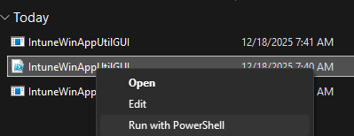
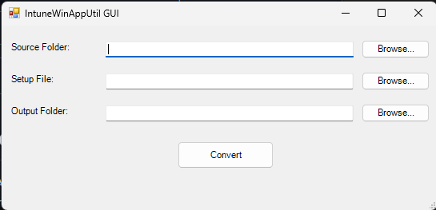

# IntuneWinAppUtil GUI

IntuneWinAppUtil GUI is a PowerShell-based graphical interface for the Microsoft Win32 Content Prep Tool (`IntuneWinAppUtil.exe`). This GUI simplifies the process of converting application installation files into the `.intunewin` format for use with Microsoft Intune.

## Features

- **User-Friendly Interface**: Simplifies the packaging process with a graphical interface.
- **Drag-and-Drop**: Supports drag-and-drop functionality for source folders and setup files.
- **Paths with spaces**: Folder and file names with spaces work.
- **Browse Buttons**: Allows users to browse and select the source folder, setup file, and output folder.
- **Automated Packaging**: Automates the command-line usage of the Microsoft Win32 Content Prep Tool.
- **Portable Mode**: Can be run as a PowerShell script or as a standalone EXE.

## Prerequisites

- **IntuneWinAppUtil.exe**: Download the official Microsoft Win32 Content Prep Tool from the [Microsoft GitHub Repository](https://github.com/Microsoft/Microsoft-Win32-Content-Prep-Tool).
- **Windows PowerShell 5.1** (recommended for GUI stability).

## Installation

1. **Create a Folder**:
   - Create a folder and name it **IntuneGUI**
   - Example:
     ```
     C:\IntuneGUI
     ```

2. **Download the Files**:
   - Download `IntuneWinAppUtilGUI.exe` from the [Releases](https://github.com/mozalattar/it-automation-toolkit/releases) page, or clone this repository to use the `.ps1`.
   - Download `IntuneWinAppUtil.exe` from the Microsoft repository.

3. **Setup**:
   - Drag & drop the required files into `C:\IntuneGUI`

   **PowerShell mode**
   - `IntuneWinAppUtilGUI.ps1`
   - `IntuneWinAppUtil.exe`

   **EXE (portable) mode**
   - `IntuneWinAppUtilGUI.exe` (download it from the [Releases](https://github.com/mozalattar/it-automation-toolkit/releases) page)
   - `IntuneWinAppUtil.exe`

## Usage

### Option 1: Run using EXE (Recommended – Portable)

1. Ensure both files are in the same folder:
   ```
   IntuneWinAppUtilGUI.exe
   IntuneWinAppUtil.exe
   ```
2. Double-click **IntuneWinAppUtilGUI.exe**
3. The GUI will open automatically.

> No PowerShell window or execution policy changes are required when using the EXE.

### Option 2: Run from PowerShell (.ps1)

1. Open **PowerShell**.
2. Navigate to the folder:
   ```powershell
   cd "C:\IntuneGUI"
   ```
3. Run the script:
   ```powershell
   .\IntuneWinAppUtilGUI.ps1
   ```

> **Note:** PowerShell requires `.\` to run scripts from the current directory.

### Execution Policy (PowerShell only)

If PowerShell blocks the script, run once:
```powershell
Set-ExecutionPolicy -Scope CurrentUser RemoteSigned
```

### PowerShell 7 / GUI Not Opening

If the GUI does not open, run explicitly with Windows PowerShell and STA mode:
```powershell
powershell.exe -NoProfile -ExecutionPolicy Bypass -STA -File ".\IntuneWinAppUtilGUI.ps1"
```

## Using the GUI

- **Source Folder**: Select the folder containing all installer files.
- **Setup File**: Select the installer file **located inside the Source Folder** (e.g., `setup.exe`).
- **Output Folder**: Select the destination folder for the `.intunewin` file.
- Click **Convert** to package the application.

> **Important:**  
> The setup file **must be located inside the Source Folder**.  
> This is a requirement of Microsoft’s `IntuneWinAppUtil.exe`.

## Screenshots

**Running the script**



**The GUI**



## Notes

- `IntuneWinAppUtil.exe` must always be located next to the GUI (`.ps1` or `.exe`).
- EXE mode is fully portable and recommended for end users.
- Use Windows PowerShell 5.1 for best WinForms compatibility when running the `.ps1`.

## Building the EXE yourself

The EXE is built automatically for every release. To build it locally with [PS2EXE](https://github.com/MScholtes/PS2EXE):

```powershell
Install-Module ps2exe -Scope CurrentUser
Invoke-ps2exe .\IntuneWinAppUtilGUI.ps1 .\IntuneWinAppUtilGUI.exe -noConsole -STA
```

## License

See the [LICENSE](../../LICENSE) in the repository root.

## Disclaimer

This project is not affiliated with or endorsed by Microsoft. It is a personal project designed to provide a user-friendly interface for the official Microsoft Win32 Content Prep Tool.

## Legal Disclaimer

The contents of this repository, including all scripts and associated documentation, are provided solely for internal, educational, and non-commercial use.

## Contact

- **Mohammed AlAttar**
- Email: [mozalattar@gmail.com](mailto:mozalattar@gmail.com)
- LinkedIn: [Mohammed AlAttar](https://www.linkedin.com/in/mohammed-z-alattar/)
